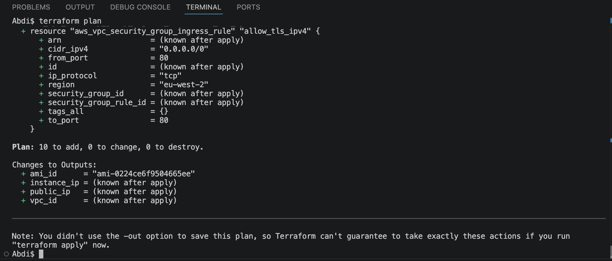
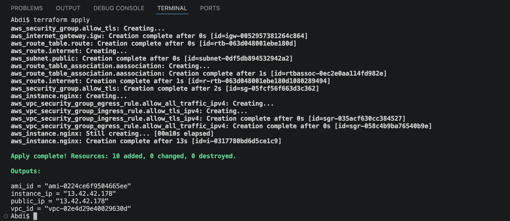
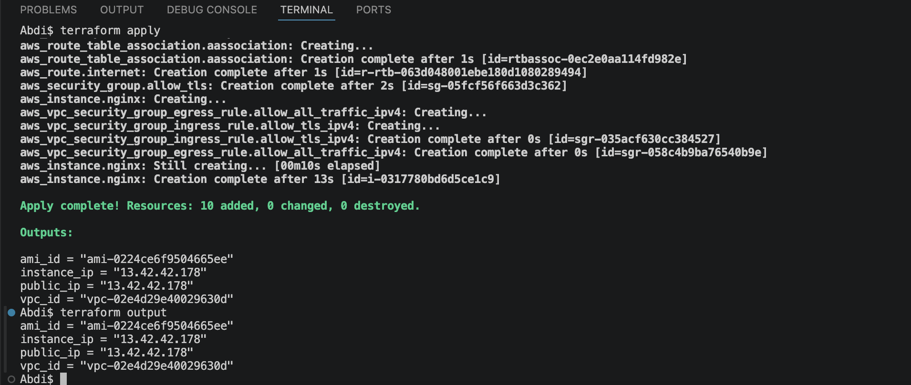
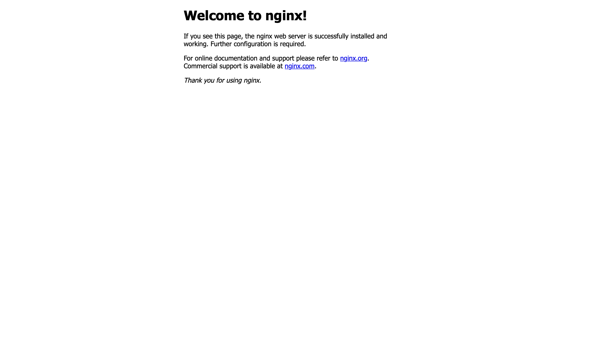
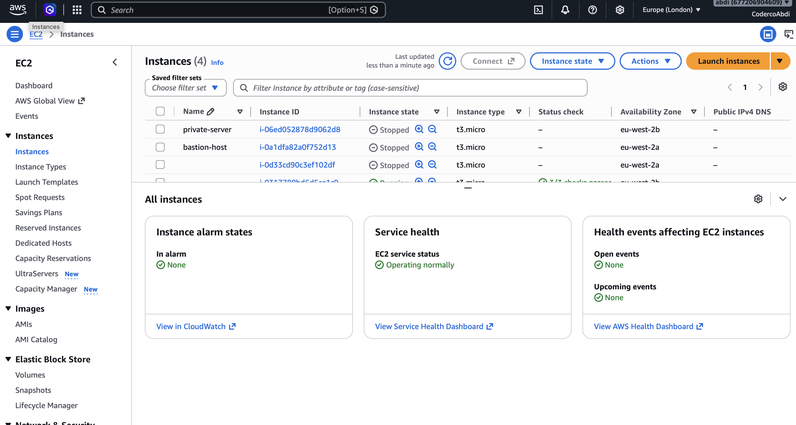

# Assignment 2 – EC2 Deployment with Terraform and Cloud-Init

## Project Overview

In this assignment, I used Terraform to provision an AWS EC2 instance running Ubuntu. I used Cloud-Init to automatically install, enable, and start NGINX when the instance launched.

The infrastructure includes a VPC, public subnet, internet gateway, route table, security group, and EC2 instance.

## Technologies Used

- Terraform
- AWS EC2 and VPC
- Cloud-Init (YAML)
- NGINX
- Git and GitHub

## Deployment Commands

The following commands were used to deploy the AWS infrastructure:

```bash
terraform init
terraform fmt
terraform validate
terraform plan
terraform apply
```

After deployment, I retrieved the EC2 public IP address using `terraform output` and successfully accessed the NGINX webpage in my browser.

## Deployment Screenshots

### 1. Terraform Plan

This screenshot shows the Terraform execution plan before deployment, including the AWS resources Terraform intended to create.



### 2. Terraform Apply

This screenshot confirms that Terraform successfully deployed the infrastructure to AWS.



### 3. Terraform Outputs

This screenshot shows the Terraform outputs after deployment, including the EC2 public IP address used to access NGINX.



### 4. NGINX Webpage

This screenshot shows the NGINX welcome page accessed through the EC2 public IP address, confirming that Cloud-Init successfully installed and started NGINX.



### 5. AWS EC2 Console

This screenshot shows the deployed EC2 instance in the AWS Management Console.



## Cleanup

To remove the AWS infrastructure after testing and avoid unnecessary charges:

```bash
terraform destroy
```

## Conclusion

This assignment helped me practise provisioning AWS infrastructure with Terraform, automating NGINX installation using Cloud-Init, and verifying a working web server deployment.
